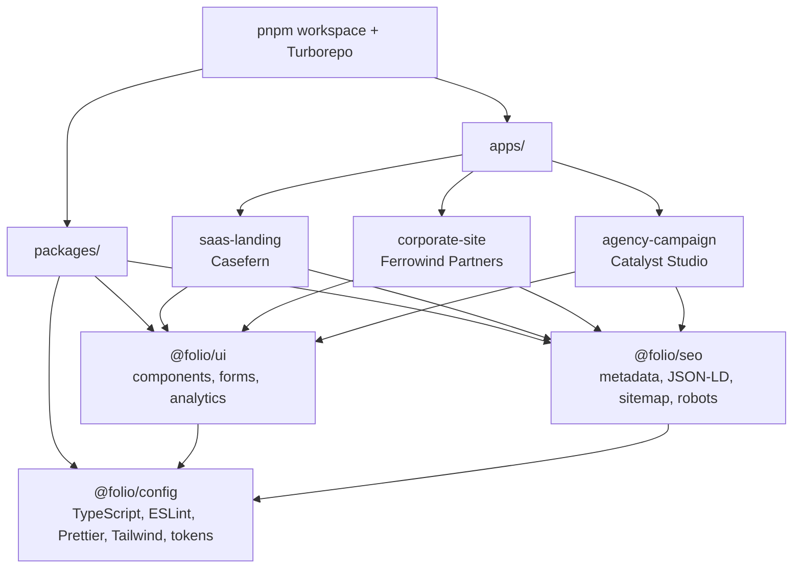

# Folio Demo Monorepo

Portfolio demos for a freelance white-label web development service. The repo
contains three static landing-page demos that double as the reference
implementations for a reusable "48-hour landing starter kit".

Everything is designed for **$0 hosting**: static Next.js exports deployed to
Cloudflare Pages. There is no server runtime, no API route, and no paid service.

> All brands, names, testimonials, metrics, and pricing are fictional demo
> content. Nothing in this repository represents a real company or commercial
> offer.

## Demos

| Demo                   | Brand                  | Purpose                                               | Stack                                                          | Live URL                                                  | Lighthouse (mobile)   |
| ---------------------- | ---------------------- | ----------------------------------------------------- | -------------------------------------------------------------- | --------------------------------------------------------- | --------------------- |
| `apps/saas-landing`    | **Casefern**           | B2B SaaS landing page with A/B hero, pricing, and FAQ | Next.js 16, TypeScript, Tailwind v3, `@folio/ui`               | `https://casefern-demo.pages.dev` (pending deploy)        | 100 / 100 / 100 / 100 |
| `apps/corporate-site`  | **Ferrowind Partners** | EN/ES industrial corporate site with MDX case studies | Next.js 16, TypeScript, Tailwind v3, `@folio/ui`, `@folio/seo` | `https://ferrowind-demo.pages.dev` (pending deploy)       | 100 / 100 / 100 / 100 |
| `apps/agency-campaign` | **Catalyst Studio**    | Themeable campaign page with UTM capture and consent  | Next.js 16, TypeScript, Tailwind v3, `@folio/ui`, `@folio/seo` | `https://catalyst-studio-demo.pages.dev` (pending deploy) | 100 / 100 / 100 / 100 |

Lighthouse figures are the medians of 3 mobile runs (393×852) against each
static production build. Per-run tables and the full methodology live in each
app README. The `agency-campaign` figure is the median across its default, dark,
and bold themes.

## Architecture



- **`apps/*`** are thin, content-driven consumers. Each owns its brand copy,
  routes, and business content.
- **`packages/ui`** owns shared components, the form adapter, and consent-gated
  analytics.
- **`packages/seo`** owns metadata, JSON-LD builders, sitemap, robots, and URL
  helpers.
- **`packages/config`** owns the shared TypeScript configs, ESLint and Prettier
  setup, Tailwind preset, and CSS-variable design tokens.

## Monorepo structure

```text
apps/
  saas-landing/      Casefern — B2B SaaS landing demo
  corporate-site/    Ferrowind Partners — industrial engineering demo
  agency-campaign/   Catalyst Studio — agency campaign demo
packages/
  config/            Shared TypeScript, ESLint, Prettier, Tailwind preset, tokens
  seo/               Metadata, JSON-LD, sitemap and robots helpers
  ui/                Shared components, form adapter, analytics hooks
docs/
  DEPLOY.md          Beginner-friendly Cloudflare Pages deployment guide
```

## Commands

```bash
pnpm install
pnpm dev                 # run all apps in parallel
pnpm lint                # ESLint across all workspaces
pnpm typecheck           # tsc --noEmit across all workspaces
pnpm build               # Turbo build for all apps
pnpm format              # Prettier write
pnpm format:check        # Prettier check

# Per-app build
pnpm --filter @folio/saas-landing build
pnpm --filter @folio/corporate-site build
pnpm --filter @folio/agency-campaign build

# Per-app static server (after build)
pnpm --filter @folio/saas-landing start
pnpm --filter @folio/corporate-site start
pnpm --filter @folio/agency-campaign start
```

Node LTS is required (see `.nvmrc`, currently `24.15.0`). pnpm is pinned through
`packageManager` (`pnpm@11.5.1`).

## Deployment

One Cloudflare Pages project per app, connected to this GitHub repository. Static
output only; no server runtime. The full step-by-step guide, project names,
environment variables, `_headers`/`_redirects` behavior, and post-deploy
checklists are in [`docs/DEPLOY.md`](docs/DEPLOY.md).

| App               | Cloudflare project     | Build command                                                                  | Output directory            |
| ----------------- | ---------------------- | ------------------------------------------------------------------------------ | --------------------------- |
| `saas-landing`    | `casefern-demo`        | `pnpm install --frozen-lockfile && pnpm --filter @folio/saas-landing build`    | `apps/saas-landing/dist`    |
| `corporate-site`  | `ferrowind-demo`       | `pnpm install --frozen-lockfile && pnpm --filter @folio/corporate-site build`  | `apps/corporate-site/dist`  |
| `agency-campaign` | `catalyst-studio-demo` | `pnpm install --frozen-lockfile && pnpm --filter @folio/agency-campaign build` | `apps/agency-campaign/dist` |

All apps use `output: "export"`, `distDir: "dist"`, `trailingSlash: true`, and
`images.unoptimized: true`. Set `NODE_VERSION=24.15.0` and
`PNPM_VERSION=11.5.1` in each Cloudflare project.

## CI

`.github/workflows/ci.yml` runs on pull requests and pushes to `main`:

1. Install with a frozen lockfile.
2. `pnpm format:check`
3. `pnpm lint`
4. `pnpm build` (all three apps)
5. `pnpm typecheck`

A separate, manually triggered `workflow_dispatch` job runs Lighthouse CI per
app against the static build and uploads the reports as artifacts. It never
blocks normal pull requests.

## Quality gates

- TypeScript strict
- ESLint + Prettier
- Static production build
- Lighthouse mobile target: **≥95** in all four categories
- Campaign themes checked with LHCI per theme (`?theme=dark`, `?theme=bold`)
- Keyboard-accessible interactions and visible focus states
- Consent-gated analytics with a no-op default
- Mock form adapter by default

## Fictional brands

- **Casefern** — fictional B2B SaaS support product
- **Ferrowind Partners** — fictional industrial engineering and consulting company
- **Catalyst Studio** — fictional creative agency campaign demo

Do not present these demos as real products or imply affiliation with a real
company.

## License

All rights reserved. This repository is a demo portfolio and is not licensed for
reuse or redistribution.
